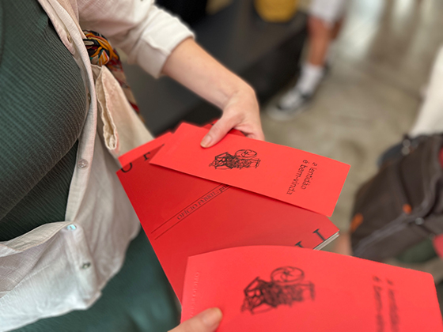

No dia 25 de julho de 2026, às 11h, o projeto ofício febril fez o lançamento do livro *ofício febril: primeiras impressões*. O projeto editorial foi desenvolvido pelos artistas e professores Aline Dias e Diego Rayck. Trata-se do primeiro livro da série *Ensaios tipográficos*, diálogo do projeto com a editora Papa Terra, sediada em Navegantes. A parceria entre as duas cidades portuárias que se inicia com este livro assume como foco o resgate contemporâneo da produção de livros com tipos móveis, trabalho que vem sendo realizado por Aline e Diego no Departamento de Artes Visuais da Ufes, onde completam dez anos de docência. Este espaço é provavelmente a única oficina de tipografia manual dedicada à experimentação artística no Espírito Santo atualmente.

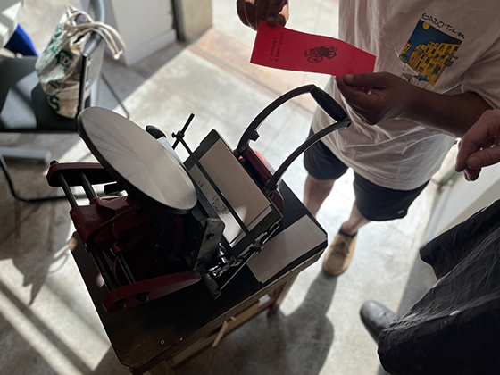

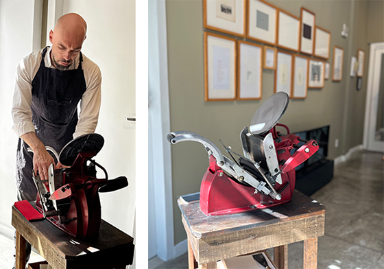

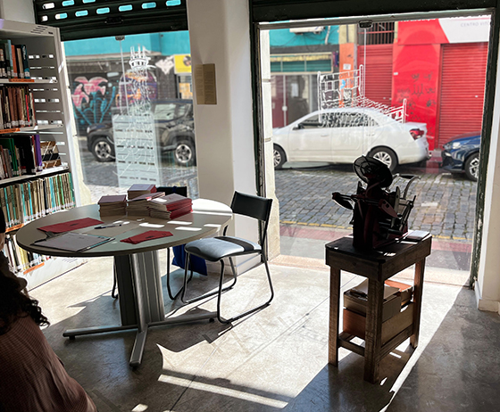

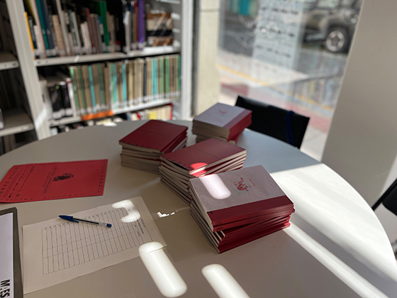

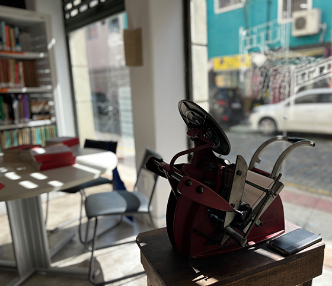
_processo de impressão tipográfica e vistas da prensa em performance no lançamento do livro na exposição **primeiras impressões**, na biblioteca do MAES, fotografias de Letícia Marinatto_

A prensa manual foi deslocada para que leitoras e leitores acompanharem o processo da tipografia manual presencialmente. Nossa prensa adana vem protagonizando uma série de ações tipográficas fora do ateliê: já esteve na praia de Camburi, na Prainha, Vila Velha, em Regência, no Hub ES, no pátio da Ufes e retorna ao MAES, onde participou do lançamento do catálogo da exposição *pele abissal* do artista Marcos Martins, precocemente falecido em setembro de 2025, a quem o livro é dedicado, *in memoriam*. 
Além da oportunidade de presenciar uma demonstração do processo de impressão tipográfica dos marca-páginas, o lançamento do livro marcou a presença do projeto na biblioteca do MAES. O livro inclui fotografias de Tom Boechat desta mostra, que apresenta cerca de 60 trabalhos envolvendo processos de composição e impressão com tipos móveis e clichês realizados por habitantes e visitantes da oficina tipográfica.

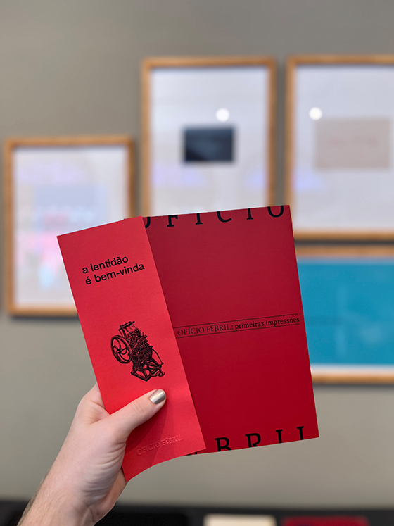
_detalhe do livro e marca página impresso no lançamento, fotografia de Letícia Marinatto_

O livro reúne ensaios, poemas, desenhos e fotografias. O texto “Febre tipográfica”, de Aline Dias & Diego Rayck narra a história do projeto e é acompanhado por desenhos de estudantes que se dedicaram a olhar atentamente o cotidiano da oficina. O ensaio “Fazer, a tipografia”, de Cristiano Moreira, apresenta uma reflexão sobre tipografia e literatura e “Tradição e tradução tipográfica”, de Jakson Chiappa, a dimensão política do trabalho e dos modos de produção gráfica a partir do acervo tipográfico. Também compõe a publicação três poemas de Leila Danziger, artista que esteve no auditório do MAES compartilhando sua pesquisa em setembro de 2025 e um dueto de poema e desenho de Luiza Leite & Tatiana Podlubny, da editora Fada Inflada. 

[O e-book pode ser acessado no Repositório da Ufes em pdf](https://repositorio.ufes.br/entities/publication/235d3154-5f40-4681-b32d-1733538bde52)

Os 330 exemplares são acompanhados por uma impressão tipográfica e uma parte desta tiragem foi distribuída gratuitamente na biblioteca do MAES. 

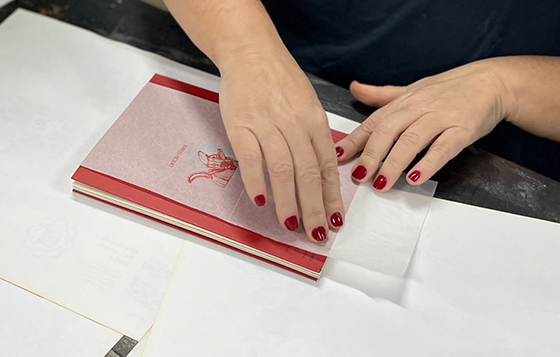

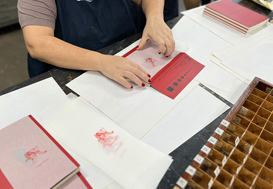

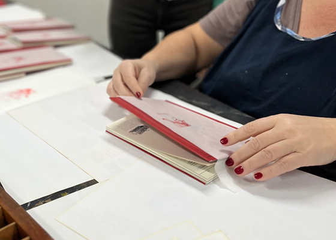

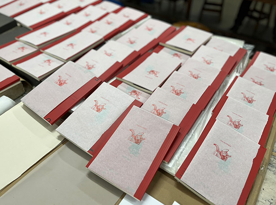
_preparação da livro no ateliê de tipografia, mãos de Gisele Girardi e fotografias de Letícia Marinatto_

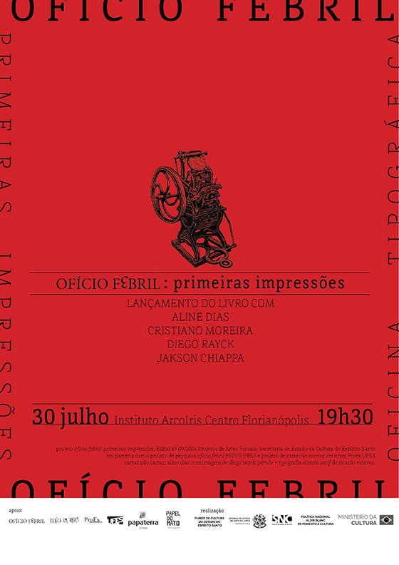
_cartaz do evento, projeto gráfico de Aline Dias_
